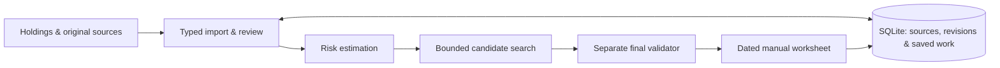

<p align="center">
  
</p>

<p align="center">
  <a href="https://github.com/jpeterson92/Prosper/actions/workflows/checks.yml"></a>
  
  
  
</p>

<p align="center"><strong>A local application for exploring tax-loss harvesting without losing sight of portfolio risk.</strong></p>

<p align="center">
  <a href="#a-look-inside">See the application</a> ·
  <a href="#the-investor-workflow">Investor workflow</a> ·
  <a href="#under-the-hood">Architecture</a> ·
  <a href="docs/showcase/ENGINEERING.md">Engineering tour</a>
</p>

---

Tax-loss harvesting connects several difficult problems: messy portfolio data, lot-level decisions, uncertain risk estimates, transaction costs, and investment constraints. A useful tool has to make those connections understandable.

**Prosper is my independent project bringing investment-product thinking into a working software system.** It imports current holdings, estimates conditional loss opportunities, models benchmark-relative risk, compares constrained whole-share proposals, and saves a dated worksheet for manual review and execution.

The project spans product design, quantitative modeling, a typed Python service, a React interface, and verification of financial calculations and state transitions.

## A look inside

### Compare the decision, not just the loss

Review no trade alongside checked proposals, inspect the effect of share quantities on estimated loss, cash and risk, then save a dated worksheet.


<sub>Actual application UI with fictional holdings and illustrative settings. Risk and loss figures are unqualified estimates; the example is not an investment recommendation.</sub>

### Turn a proposal into a checked decision

Adjust whole-share quantities and recheck the result against the saved inputs and enabled limits. The worksheet keeps the assumptions, dates and warnings with the decision.


<sub>Illustrative revision of the portfolio above. The panel reports price/basis loss, cash, costs and risk separately; price loss is not a claim of tax savings.</sub>

## The investor workflow

| Step | What the investor gets |
| --- | --- |
| **1 · Bring the holdings** | Import a current lot snapshot. Retain the original file, supplied quantities and basis, and explicit unknowns. |
| **2 · Establish the reference** | Select a dated full-holdings benchmark proxy and review market inputs, exclusions, marks and data coverage. |
| **3 · Understand the trade-offs** | Inspect conditional lot losses and estimated benchmark-relative risk. Compare no trade with constrained whole-share proposals. |
| **4 · Make the decision explicit** | Revise quantities, run final checks, and save/export an immutable, dated manual worksheet. |
| **5 · Return with current facts** | Reopen saved work or import refreshed holdings after external account changes. |

Prosper stops at the advisory worksheet. The investor executes at the broker; the application does not place orders or reconstruct an account from assumed fills.

## Under the hood



| Layer | Implementation |
| --- | --- |
| **Investor interface** | React + strict TypeScript; generated API contracts; explicit review, comparison and worksheet controls. |
| **Local application service** | FastAPI + Pydantic; protected loopback requests; structured errors and revision-aware mutations. |
| **Portfolio data** | Polars for ingestion, joins, alignment and coverage; original source bytes and located unknowns retained. |
| **Quantitative core** | NumPy + SciPy; OHLC-derived innovations, univariate volatility, dynamic conditional correlation and nonlinear covariance shrinkage. |
| **Portfolio decisions** | Bounded whole-share candidate construction, with a separate validator recomputing financial feasibility from canonical inputs. |
| **Saved state** | SQLite transactions, immutable snapshots/results, durable retry receipts, and current-format backup/restore. |

The selected risk method is **IDR-DCC-NL**. One covariance estimate supports tracking-error and exposure analysis. Search limits remain visible; a bounded search does not claim a global optimum or prove infeasibility.

## Engineering choices that matter

- **Unknown stays unknown.** Missing basis, incomplete prices or incompatible history produce located diagnostics. They do not silently become zero, fabricated observations or a smaller fitted universe.
- **Search does not validate itself.** Proposed orders pass a separate final check of quantities, cash, costs, gains, risk and enabled investor limits.
- **A retry is not another trade plan.** Durable command identities distinguish an identical retry from changed input. Revision checks prevent late work from replacing newer state.
- **Saved output is a record of a decision.** Historical worksheets retain their original inputs, assumptions and results. Reopening or restoring them does not refit the model.
- **Financial precision has a boundary.** Supplied quantities, basis and entered amounts retain decimal text; derived analytics use Float64, with calculation-specific tolerances and discrete financial checks.
- **Verification reaches the workflow.** The suite includes hand-derived financial cases, numerical reference checks, protected API tests, browser journeys, interruption/stale-state cases, and source-preserving recovery.

## Explore the code

| If you are interested in… | Start here |
| --- | --- |
| Translating the investor journey into an application | [Workspace orchestration](src/prosper/workspace.py) · [React review interface](frontend/src/review.tsx) |
| Quantitative methods and input conventions | [OHLC innovations](src/prosper/innovations.py) · [Volatility fitting](src/prosper/volatility.py) · [DCC](src/prosper/dcc.py) · [Shrinkage](src/prosper/shrinkage.py) |
| Constrained decisions and financial correctness | [Candidate construction](src/prosper/candidate_search.py) · [Final validation](src/prosper/candidate_validation.py) · [Reference cases](tests/test_candidate_reference.py) |
| Traceable data and reliable state | [Data records](src/prosper/advisory_records.py) · [Transactional store](src/prosper/advisory_store.py) · [Recovery](src/prosper/advisory_recovery.py) |
| Turning a checked proposal into a usable deliverable | [Worksheet service](src/prosper/worksheets.py) · [Worksheet interface](frontend/src/worksheets.tsx) |

For a more detailed walkthrough, read the [engineering tour](docs/showcase/ENGINEERING.md).

## Project status

**Working development prototype.** The implemented path runs from source import through exploratory modeling, checked candidates, worksheets and recovery. Automated examples and public screenshots use fictional portfolios.

The next product work focuses on reducing first-session preparation: standard defaults, clearer exceptions, and a simpler path from holdings and benchmark selection to a basic proposal. Independent tax/model review, calibration, qualified financial inputs and release readiness remain separate milestones. The software is not currently authorized for financial reliance.

## Development

The current development host is **Windows x64**, with Python 3.12, PowerShell and a local browser. Dependencies are locked; helpers manage the project environment.

```powershell
# Python environment and affected checks
./scripts/dev.ps1 -Command bootstrap
./scripts/dev.ps1 -Command dev

# Browser dependencies and production assets
./scripts/frontend.ps1 -Command bootstrap
./scripts/frontend.ps1 -Command build
```

See the [development guide](docs/engineering/DEVELOPMENT.md) for launch commands and verification scopes. The [local application guide](docs/guides/LOCAL_ARTIFACT.md) explains workspace initialization, source review and recovery.

<details>
<summary><strong>Product, methodology and project documentation</strong></summary>

- [Product specification](docs/product/SPEC.md)
- [Architecture](docs/architecture/ARCHITECTURE.md) and [data contracts](docs/architecture/DATA_CONTRACTS.md)
- [Risk model](docs/domain/RISK_MODEL.md), [portfolio construction](docs/domain/PORTFOLIO_CONSTRUCTION.md) and [tax-policy framework](docs/domain/TAX_POLICY.md)
- [Verification and acceptance](docs/engineering/VALIDATION.md)
- [Security](SECURITY.md), [contribution framework](CONTRIBUTING.md) and [agent working agreement](AGENTS.md)
- [Current implementation status](docs/STATUS.md) and [delivery plan](docs/PROJECT_PLAN.md)

</details>

Software licensing and public contribution terms have not yet been selected. Third-party market-data rights are separate from code availability. Keep private portfolio files and credentials outside the repository.
