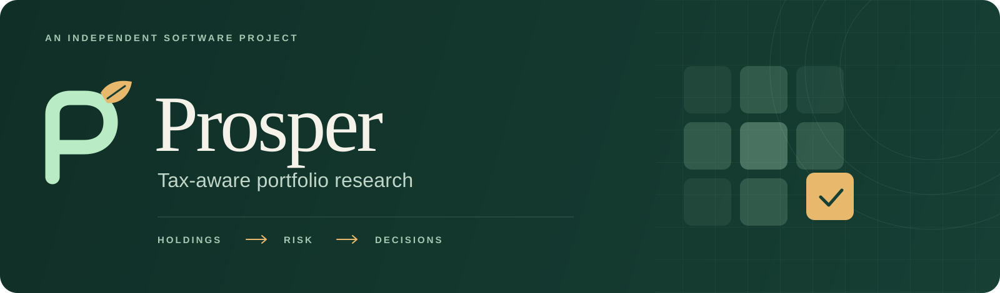
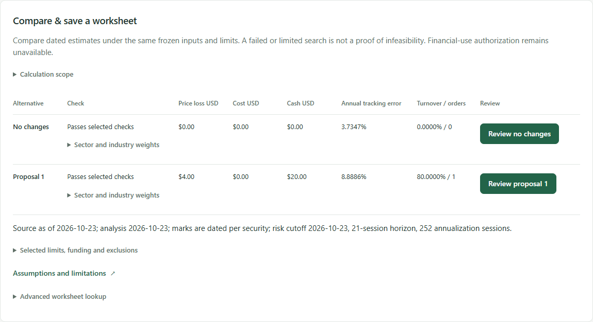
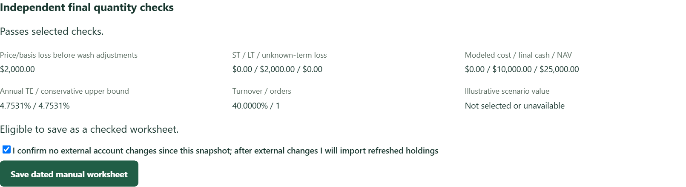
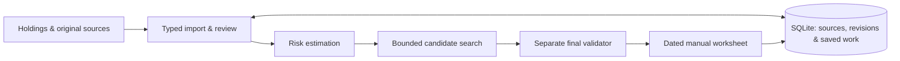

<p align="center">
  
</p>

<p align="center">
  <a href="https://github.com/jpeterson92/Prosper/actions/workflows/checks.yml"></a>
  
  
  
</p>

<p align="center"><strong>Risk-optimized tax-loss harvesting in your own brokerage account.</strong></p>

<p align="center">
  <a href="#a-look-inside">See the application</a> ·
  <a href="#the-investor-workflow">Investor workflow</a> ·
  <a href="#under-the-hood">Architecture</a> ·
  <a href="docs/showcase/ENGINEERING.md">Engineering tour</a>
</p>

---

Prosper is being built to give individual investors and small registered investment advisers (RIAs) free, open-source tools for tax-loss harvesting in their own brokerage accounts.

Given your holdings, tax lots and benchmark, it compares potential trades by estimated loss, transaction costs, cash and portfolio risk. You can adjust the quantities, check them against your limits, and save a worksheet to use at your broker.

## A look inside

### Compare proposals

See how each proposal changes estimated losses, cash and risk relative to keeping your current holdings.



<sub>Actual application UI with fictional holdings and illustrative settings. Risk and loss figures are unqualified estimates; the example is not an investment recommendation.</sub>

### Adjust quantities and save a worksheet

Change the proposed share quantities and run the checks again. The saved worksheet includes the trades, estimates, assumptions, dates and warnings.



<sub>Illustrative revision of the portfolio above. The panel reports price/basis loss, cash, costs and risk separately; price loss is not a claim of tax savings.</sub>

## The investor workflow

| Step | What you do |
| --- | --- |
| **1 · Import holdings** | Bring in your current tax lots. Review quantities, cost basis and any missing information. |
| **2 · Choose a benchmark** | Select a dated benchmark proxy and review its holdings, prices, history and exclusions. |
| **3 · Compare proposals** | Look at estimated losses, costs, cash and benchmark-relative risk for whole-share trades. |
| **4 · Review and save** | Adjust quantities, run final checks, and export a dated worksheet. |
| **5 · Refresh next time** | Import updated holdings after trading or other account changes. Previous worksheets remain available. |

You place the trades at your broker. Prosper uses a refreshed holdings import to reflect subsequent account changes.

## Under the hood



| Layer | Implementation |
| --- | --- |
| **Interface** | React + strict TypeScript, with generated API contracts. |
| **Application service** | FastAPI + Pydantic, running locally with authenticated requests and revision checks. |
| **Portfolio data** | Polars for imports, joins, history alignment and coverage checks. Original files and missing values are retained. |
| **Quantitative core** | NumPy + SciPy; OHLC-derived innovations, univariate volatility, dynamic conditional correlation and nonlinear covariance shrinkage. |
| **Trade proposals** | Whole-share search with separate checks for quantities, cash, costs, gains and enabled risk limits. |
| **Storage** | SQLite transactions, saved inputs/results, retry handling and backup/restore. Reopening a worksheet preserves its original calculations. |

The risk model is **IDR-DCC-NL**, described in the [risk-model documentation](docs/domain/RISK_MODEL.md). Its covariance estimate is used to calculate tracking error and risk exposures. Candidate search is bounded; it does not guarantee the best possible portfolio.

## Explore the code

| Area | Code |
| --- | --- |
| Application and UI | [Workspace](src/prosper/workspace.py) · [React interface](frontend/src/review.tsx) |
| Risk estimation | [OHLC innovations](src/prosper/innovations.py) · [Volatility fitting](src/prosper/volatility.py) · [DCC](src/prosper/dcc.py) · [Shrinkage](src/prosper/shrinkage.py) |
| Trade construction and checks | [Candidate search](src/prosper/candidate_search.py) · [Final validation](src/prosper/candidate_validation.py) · [Reference cases](tests/test_candidate_reference.py) |
| Data and storage | [Records](src/prosper/advisory_records.py) · [SQLite store](src/prosper/advisory_store.py) · [Recovery](src/prosper/advisory_recovery.py) |
| Worksheets | [Service](src/prosper/worksheets.py) · [Interface](frontend/src/worksheets.tsx) |

For a more detailed walkthrough, read the [engineering tour](docs/showcase/ENGINEERING.md).

## Project status

**Development prototype.** The current application supports imports, exploratory risk estimates, checked proposals, worksheets and recovery. The screenshots and automated examples use fictional portfolios.

Current work focuses on making setup easier, with standard defaults and clearer review of missing or excluded inputs. Independent tax/model review, calibration, input qualification and release checks are still required before financial use.

## Development

The current development host is **Windows x64**, with Python 3.12, PowerShell and a local browser. Dependencies are locked; helpers manage the project environment.

```powershell
# Python environment and affected checks
./scripts/dev.ps1 -Command bootstrap
./scripts/dev.ps1 -Command dev

# Browser dependencies and production assets
./scripts/frontend.ps1 -Command bootstrap
./scripts/frontend.ps1 -Command build
```

See the [development guide](docs/engineering/DEVELOPMENT.md) for launch commands and verification scopes. The [local application guide](docs/guides/LOCAL_ARTIFACT.md) explains workspace initialization, source review and recovery.

<details>
<summary><strong>Product, methodology and project documentation</strong></summary>

- [Product specification](docs/product/SPEC.md)
- [Architecture](docs/architecture/ARCHITECTURE.md) and [data contracts](docs/architecture/DATA_CONTRACTS.md)
- [Risk model](docs/domain/RISK_MODEL.md), [portfolio construction](docs/domain/PORTFOLIO_CONSTRUCTION.md) and [tax-policy framework](docs/domain/TAX_POLICY.md)
- [Verification and acceptance](docs/engineering/VALIDATION.md)
- [Security](SECURITY.md), [contribution framework](CONTRIBUTING.md) and [agent working agreement](AGENTS.md)
- [Current implementation status](docs/STATUS.md) and [delivery plan](docs/PROJECT_PLAN.md)

</details>

Prosper is being built toward free, open-source distribution. A software license and public contribution terms have not yet been selected. Third-party market-data rights are separate from code availability. Keep private portfolio files and credentials outside the repository.
