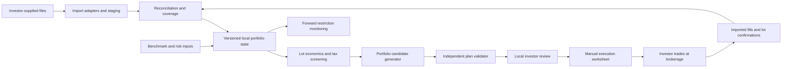

# Adopted architecture

Status: architecture adopted by the project owner on October 22, 2026. See [ADR-0001](decisions/0001-adopt-project-architecture.md). T003.1 supplies the locally verified Python developer baseline and [T003.2](../tasks/T003.2-exact-values.md) adds exact-value/synthetic diagnostic allocation primitives. [T004.1.1](../tasks/T004.1.1-synthetic-bundle-parsing.md) adds a strictly parsed synthetic bundle/evidence boundary. [STATUS](../STATUS.md) records current implementation and unverified layers; this architecture document does not independently duplicate release/progression state. Architecture acceptance is not implementation verification or authorization.

The [technology tradeoff review](TECHNOLOGY_TRADEOFFS.md) explains the reasoning, strong alternatives, pros/cons and qualification triggers for thirteen primary choices. Its recommended baseline and staged learning policy are now adopted; alternatives and unqualified experimental components remain explicitly separate.

## Shape and boundaries

Start with a modular local application, one repository and one authoritative local store. Keep broker file parsing, tax policy, portfolio construction, application workflow and presentation separate. Use a React/TypeScript interface and a Python backend, with a local compute worker only when needed. This is one application with clear boundaries, not a promise that every component runs in a literal single process. Do not start with microservices, hosted authentication, a job cluster or an agent-orchestration framework.

No application component connects to or mutates the brokerage in the initial design. That arrow represents the investor operating their brokerage. External files are untrusted inputs requiring validation.

## Module ownership

| Future boundary | Responsibilities | Must not do |
| --- | --- | --- |
| `domain/portfolio` | Security/account/lot identity, decimal money, position/cash state | Parse broker-specific columns |
| `domain/tax` | Supported lot economics, eligibility, coverage, identity/restrictions | Infer unknown law from correlations or LLM output |
| `domain/risk` | Benchmark exposures, covariance validation, TE calculation | Silently replace unavailable risk evidence |
| `domain/planning` | Candidate selection, order rounding, infeasibility explanations | Submit trades or self-certify hard constraints |
| `domain/validation` | Independently recompute plan feasibility and economics | Trust solver status without checks |
| `application` | Import/review/approve/reconcile use cases, invalidation and lifecycle | Hide financial rules in UI handlers |
| `adapters` | File readers, local store, licensed data access later, report export | Redefine canonical semantics |
| `apps` | Local UI and a thin internal diagnostic entry point | Own independent versions of financial calculations |

This table is a future map, not a requirement to create every package before the first slice. Create code modules when real behavior needs them. See [src/prosper](../../src/prosper/README.md).

## Technology direction and tradeoffs

- **Python core, adopted.** Supports readable financial logic and numerical workflows in one language. Use exact decimal values for book money and quantities. Risk/optimization arrays use explicitly documented floating-point conversion and tolerances; never feed rounded solver output directly into financial records.
- **SQLite authority, adopted.** Suits a local single-user application with transactional state. Use canonical decimal strings stored in TEXT under the [foundation numeric contract](../engineering/FOUNDATION_SPEC.md), with source quantum, field rules and exact round-trip tests; a DECIMAL column declaration alone is insufficient. Keep migrations versioned and reversible or backed by a documented restore path. Encryption is a separate design decision; a database file is not automatically encrypted.
- **Modern analytics, adopted with staging.** Polars for typed ingestion/history transforms and Parquet for immutable analytical inputs. Add DuckDB for research SQL when a concrete query warrants it; derived stores must be rebuildable and cannot independently mutate authoritative basis or approvals.
- **React/TypeScript browser UI, adopted.** Use Vite and routing as needed, with a deliberate lot/plan/risk review experience. This adds frontend learning and implementation cost relative to a Python dashboard. No frontend framework or Node toolchain has been installed. The release must support an investor who does not use a CLI for routine work.
- **FastAPI/Pydantic contracts, adopted.** Expose shared application services through a local API and generate a TypeScript client from OpenAPI. Exact book values travel as validated decimal strings; financial rules remain in the domain core. HTTP origin/session controls and solver request isolation need verification.
- **Numerical direction adopted; qualification pending.** CVXPY with Clarabel provides continuous reference/relaxation models. Clarabel does not solve the full mixed-integer order/lot problem. Qualify discrete candidate construction or SCIP/another suitable solver and independently validate rounded outputs. No commercial solver dependency is assumed.
- **Risk and research, adopted.** Start with a reviewed shrinkage covariance reference, initially evaluating Ledoit-Wolf, and use marimo for reproducible risk/solver comparisons. Data/settings and numerical validation remain open.
- **Packaging evaluation, adopted.** Begin with a local browser launcher. Evaluate Tauri 2 with a packaged Python sidecar after an accepted end-to-end workflow; select it for release only if qualification passes. Do not rewrite the financial core in Rust to get desktop packaging.
- **Engineering baseline, adopted.** Use uv/Ruff, strict typing, pytest/Hypothesis and Playwright; qualify the checker and compatible versions. Begin with structured private local diagnostics and add OpenTelemetry when justified, without a default remote exporter.
- **Provider-independent files, adopted first boundary.** A canonical import format makes synthetic development possible before a brokerage is chosen. Broker adapters require separate qualification; do not promise universal CSV support.

No runtime AI provider is required. Coding agents help build the product; the product's financial decisions are deterministic. The adopted staged plan includes an optional later read-only AI explainer operating on verified plan facts and reviewed sources, with evaluation and explicit data-disclosure controls. It cannot approve plans, write basis or place trades. New database/WASM, JAX or AI experiments remain removable until results justify production adoption. Reserve roughly 20% of total engineering effort for explicit learning experiments and run one exploratory track at a time.

## State, provenance and reproducibility

Keep four layers distinct: original imported evidence, normalized staged records, committed portfolio snapshots/events, and derived analysis/plan artifacts. Every derived result references immutable input versions, rule versions, benchmark/risk versions, settings, and code version when available. Local logs are inspectable audit evidence, not tamper-proof legal records.

An opening snapshot establishes a cutoff. Do not replay earlier activity into holdings already represented in that snapshot. Historical events can inform eligibility without changing the same holdings twice. Corrections supersede prior records while retaining provenance. Import preview/commit is transactional: failed validation leaves the last committed state intact.

The cutoff must include the source's event-inclusion convention (for example, trade-date versus settled/closing state), not just a report date. Same-day event inclusion must be established by source evidence or an explicitly reconciled sequence. Ambiguous inclusion stays in staging; do not invent a timestamp or apply events twice. Hypothetical fills belong in a shadow scenario, while imported actual fills and authoritative checkpoints update actual state.

Preserve both effective time and recorded time so a late correction can be distinguished from what the application knew when an earlier plan was approved. Versioned relational evidence plus explicit lifecycle transitions is the adopted baseline; full event sourcing/CQRS remains a deferred alternative.

Use stable internal security and lot identifiers. Tickers are display aliases with validity periods. Reorganizations, ticker changes, renamed share classes and transferred lots must preserve or explicitly resolve identity. Unsupported events block dependent recommendations.

## Plan lifecycle and invalidation

Separate plan lifecycle from tax-monitoring state. Adopted plan lifecycle:

`draft -> validated -> investor-approved -> execution-recorded -> reconciled`

A plan can instead become rejected, expired or superseded. Execution-recorded may contain partial fills and exceptions. Reconciled means actual holdings, cash and lot allocations match documented evidence; forward tax monitoring can remain open afterward.

Approval pins an immutable plan hash/version. New quotes beyond freshness tolerance, new activity/lots, cash changes, new restrictions, corrected imports, changed settings or tax/risk versions invalidate dependent unexecuted plans. Reserve lots/cash for an active approved worksheet. A reservation can be released after rejection/expiry only when the investor confirms no external execution/order commitment exists; otherwise retain an execution-uncertainty hold until reconciled. Expiry invalidates recommendation freshness and does not cancel a broker order or prove that shares/cash are free.

Actual fills are distinct from intentions. Import fills and broker-confirmed allocations independently of the planner, match with explicit keys, and flag ambiguous assignments. Never blindly rerun an approved plan after partial execution.

## Analysis, approval and command consistency

An analysis reads one frozen input bundle: reconciled state generation, source/coverage/restriction versions, benchmark/risk/quote versions, constraint/policy versions and computation version. Give each run an ID and cancellation/status record. A worker computes from that immutable bundle and cannot mutate portfolio state or reservations. Do not keep a database write transaction open during optimization.

The authoritative application writer compares relevant input generations when publishing a result and again when approving/reserving a plan. Approval and reservation changes occur atomically. A late/stale worker result may be retained as non-actionable evidence; it cannot replace a newer result or bypass fresh validation. Repeated mutation commands use scoped idempotency keys: same key/same payload returns the prior outcome, while same key/different payload is rejected. Two UI windows cannot reserve the same available shares.

Distinguish input-incomplete, stale, validated-candidate, no-qualified-candidate-found, search-timeout/canceled, numerically-invalid and proven-infeasible results. A heuristic finding nothing does not prove that no feasible portfolio exists. A no-trade baseline may itself breach constraints; label that explicitly. Only qualified solver evidence for the exact model supports proven infeasibility. A frontend response/code-generation type does not establish actionability.

Readiness is component- and dependency-aware: account quantity/cash reconciliation, sell-lot basis/holding evidence, household restrictions, risk/benchmark coverage and execution commitments are separate checks. Each block has a reason, scope and remediation. Exclude an affected candidate/lot only where the dependency boundary is known; if impact cannot be bounded, block the account-level actionable plan. Diagnostics can remain available with incomplete labels.

## Security and local operation

Private investor runtime storage must be outside the source repository by default, independent of source hosting. On Windows, a per-user local application-data directory is a candidate for installed application state; final path and override behavior are implementation decisions. Do not create it now. Standard local filesystem folders are the baseline. Developer dependencies live in `.venv`; synthetic test databases, caches, logs and browser/package outputs may live in ignored project-local directories under [ADR-0003](decisions/0003-adopt-standard-local-development.md). Validate intended runtime paths and private-data separation rather than guessing sync providers from folder names. Keep private worktrees/sessions separate from real investor data. Use OS-provided credential storage if later needed; do not store tokens in SQLite or project files by default.

Bind the UI to loopback, validate origin/request boundaries, restrict file access to explicit selections and configured runtime paths, avoid sensitive URL/query values, and escape imported text in reports. Protect import resource limits and spreadsheet formula injection on exports. Use a single local writer/lock policy and transactional updates to avoid two application windows corrupting state.

The first runtime should work offline after user-supplied data is loaded. Future price-provider calls require explicit provider choice, licensing, data freshness and network behavior. No telemetry of holdings is proposed. Redacted support bundles are opt-in and previewable.

Offline operation includes bundled UI assets/fonts; do not assume a locally launched UI is private if it loads remote analytics, scripts or external resources. Runtime boundaries include scratch files, worker outputs, browser state and generated reports. Exceptions for network data access require an explicit provider/purpose and visible freshness/rights semantics.

## Deployment and recovery

Prototype setup can initially target developers. Private alpha needs tested installation for the chosen operating system, a documented update process, schema migration tests, verified local backup/restore and clear removal/export behavior. Backups containing portfolios are private data and use a user-chosen secure destination. A source download is not an investor-ready install.

Before public distribution, select software license and dependency/data rights, pin dependencies, produce reproducible release evidence, document support scope and identify the release artifact. No automatic deployment or application update is implied by an agent's ability to run tools.

Recovery must cover the database plus authoritative referenced evidence/risk-input files with a versioned application manifest. Use a consistent SQLite backup mechanism, not an uncoordinated copy of an active database. Publish complete immutable files before committing their references; recover/clean up staged orphan files without removing committed evidence. Backups/migrations need interrupted-operation and missing-file checks. Rebuildable analytical caches are distinct from evidence required to reproduce prior decisions. Restored plans remain non-actionable until external execution commitments, coverage and freshness are reconciled.

The [pre-implementation review](../reviews/2026-10-22-pre-implementation-review.md) records the original findings and readiness checkpoints. [ADR-0002](decisions/0002-adopt-critical-review-actions.md) adopts the follow-up product choices; feasibility evidence remains outstanding. These engineering clarifications preserve the adopted stack; no implementation behavior has been verified.
