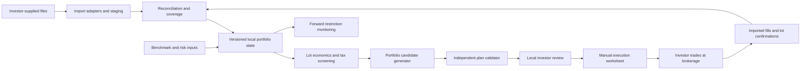

# Adopted architecture

Status: architecture adopted by the project owner on October 22, 2026. See [ADR-0001](decisions/0001-adopt-project-architecture.md). T003.1 supplies the locally verified Python developer baseline and [T003.2](../tasks/T003.2-exact-values.md) adds exact-value/synthetic diagnostic allocation primitives. [T004.1.1](../tasks/T004.1.1-synthetic-bundle-parsing.md) adds a strictly parsed synthetic bundle/evidence boundary. [STATUS](../STATUS.md) records current implementation and unverified layers; this architecture document does not independently duplicate release/progression state. Architecture acceptance is not implementation verification or authorization.

The [technology tradeoff review](TECHNOLOGY_TRADEOFFS.md) explains the reasoning, strong alternatives, pros/cons and qualification triggers for thirteen primary choices. Its recommended baseline and staged learning policy are now adopted; alternatives and unqualified experimental components remain explicitly separate.

Current scope: [D046/ADR-0012](decisions/0012-adopt-proportional-advisory-scope.md) and [D047/ADR-0013](decisions/0013-adopt-unreleased-clean-break-development.md). T019 replaces superseded implementations without backward-compatibility obligations. The [data](DATA_CONTRACTS.md) and [numerical](../engineering/ADVISORY_NUMERICS.md) contracts own the current records/precision; STATUS distinguishes requirements from implementation evidence.

## Shape and boundaries

Start with a modular local application, one repository and one authoritative local store. Keep broker file parsing, tax policy, portfolio construction, application workflow and presentation separate. Use a React/TypeScript interface and a Python backend, with a local compute worker only when needed. This is one application with clear boundaries, not a promise that every component runs in a literal single process. Do not start with microservices, hosted authentication, a job cluster or an agent-orchestration framework.

No application component connects to or mutates the brokerage in the initial design. That arrow represents the investor operating their brokerage. External files are untrusted inputs requiring validation.

## Module ownership

| Future boundary | Responsibilities | Must not do |
| --- | --- | --- |
| `domain/portfolio` | Security/account/lot identity, decimal money, position/cash state | Parse broker-specific columns |
| `domain/tax` | Supported lot economics, eligibility, coverage, identity/restrictions | Infer unknown law from correlations or LLM output |
| `domain/risk` | Benchmark exposures, covariance validation, TE calculation | Silently replace unavailable risk evidence |
| `domain/planning` | Candidate selection, order rounding, infeasibility explanations | Submit trades or self-certify hard constraints |
| `domain/validation` | Independently recompute plan feasibility and economics | Trust solver status without checks |
| `application` | Import/review/approve/reconcile use cases, invalidation and lifecycle | Hide financial rules in UI handlers |
| `adapters` | File readers, local store, licensed data access later, report export | Redefine canonical semantics |
| `apps` | Local UI and a thin internal diagnostic entry point | Own independent versions of financial calculations |

This table is a future map, not a requirement to create every package before the first slice. Create code modules when real behavior needs them. See [src/prosper](../../src/prosper/README.md).

## Technology direction and tradeoffs

- **Python core, adopted.** Supports readable financial logic and numerical workflows in one language. Preserve supplied quantities/basis as decimal text; use Float64 analytics under the advisory numerical contract. Risk/optimization arrays use explicitly documented floating-point conversion and tolerances; never feed rounded solver output directly into financial records.
- **SQLite authority, adopted.** Suits a local single-user application with transactional state. Use decimal TEXT for supplied quantities/basis and ordinary numerical fields for estimates under the [advisory numeric contract](../engineering/ADVISORY_NUMERICS.md); source files preserve original spelling without a universal quantum framework. D047 permits breaking schema changes with a documented scoped fresh development runtime/reimport; no migration support is required. Encryption is a separate design decision; a database file is not automatically encrypted.
- **Modern analytics, adopted with staging.** Polars is the first-class default for tabular development under [agent policy](../../AGENTS.md#engineering-and-decisions), including holdings and typed ingestion/history transforms; [T006.P](../tasks/T006.P-polars-migration-plan.md) owns initial dependency qualification and existing-code migration. Parquet serves immutable analytical inputs when a consumer requires persistence. Add DuckDB for research SQL when a concrete query warrants it; derived stores must be rebuildable and cannot independently mutate authoritative basis or approvals.
- **React/TypeScript browser UI, adopted.** Use Vite and routing as needed, with a deliberate lot/plan/risk review experience. This adds frontend learning and implementation cost relative to a Python dashboard. [T004.4.1.1](../tasks/T004.4.1.1-browser-client.md) qualifies the minimal diagnostic frontend/client/Node/browser boundary; [T004.4.1.2](../tasks/T004.4.1.2-inspection-ui.md) now qualifies synthetic preview/current inspection. Lifecycle, risk and plan UI remain future work. The release must support an investor who does not use a CLI for routine work.
- **FastAPI/Pydantic contracts, adopted.** Expose shared application services through a local API and generate a TypeScript client from OpenAPI. Exact book values travel as validated decimal strings; financial rules remain in the domain core. HTTP origin/session controls and solver request isolation need verification.
- **Numerical direction adopted; qualification pending.** CVXPY with Clarabel provides continuous reference/relaxation models. Clarabel does not solve the full mixed-integer order/lot problem. Qualify discrete candidate construction or SCIP/another suitable solver and independently validate rounded outputs. No commercial solver dependency is assumed.
- **Risk and research, adopted.** [D041/ADR-0007](decisions/0007-adopt-enhanced-dcc-nl-industry-risk.md) selects enhanced DCC-NL, targeting IDR-DCC-NL with qualified daily OHLC and analytical nonlinear shrinkage. One frozen covariance/forecast supplies total TE and signed sector/industry attribution; explicit group exposure limits use versioned classifications. Standard DCC-NL parity, fitting/forecast/coverage and independent calibration remain required. No added factor covariance or unqualified variant substitution. [D042/ADR-0008](decisions/0008-adopt-python-dcc-implementation.md) adopts maintained Python delivery with qualified NumPy/SciPy, owner-validated reference rights and no investor MATLAB/MEX runtime. Exact versions and an optional `arch` reference/component remain to qualify. marimo retains focused v1 qualification; broad family comparisons stay v2.
- **Packaging evaluation, adopted.** Begin with a local browser launcher. Evaluate Tauri 2 with a packaged Python sidecar after an accepted end-to-end workflow; select it for release only if qualification passes. Do not rewrite the financial core in Rust to get desktop packaging.
- **Engineering baseline, adopted.** Use uv/Ruff, strict typing, pytest/Hypothesis and Playwright; qualify the checker and compatible versions. Begin with structured private local diagnostics and add OpenTelemetry when justified, without a default remote exporter.
- **Provider-independent files, adopted first boundary.** A canonical import format makes synthetic development possible before a brokerage is chosen. Broker adapters require separate qualification; do not promise universal CSV support.

No runtime AI provider is required. Coding agents help build the product; the product's financial decisions are deterministic. The adopted staged plan includes an optional later read-only AI explainer operating on verified plan facts and reviewed sources, with evaluation and explicit data-disclosure controls. It cannot approve plans, write basis or place trades. New database/WASM, JAX or AI experiments remain removable until results justify production adoption. Reserve roughly 20% of total engineering effort for explicit learning experiments and run one exploratory track at a time.

## State, provenance and reproducibility

Keep source imports, normalized current snapshot, and saved input/settings/output bundles. Retain original source files once and relevant IDs/as-of/units/row errors. A checksum can identify/corruption-check a file; a general chain/proof registry is not required. Sources and portfolio payloads remain private.

Import selection/replacement is transactional and retry-safe; failure preserves the selected snapshot. Start from holdings/lot snapshots, not an account reconstruction from activity. Activity/restrictions can inform screening without adding shares or basis again. A new corrected import or analysis leaves saved historical outputs readable.

Stable internal/source security and lot references prevent mistaken trades. Preserve supplied quantities/basis at a small decimal boundary; derived estimates use ordinary numerical representations. Do not use a ticker alone to resolve identity or silently discard unknowns. General bitemporal/event-ledger modeling and per-intermediate proof objects are unnecessary in v1.

## Plan lifecycle and invalidation

Advisory workflow: `current inputs -> analysis -> independently checked suggestion -> save/export`. A run can also be incomplete, failed, canceled, stale or yield no qualified candidate. Keep saved estimates immutable as historical outputs; edits/reanalysis create another result.

A saved worksheet is not an approval transaction, reservation, submission or fill. Do not track available broker shares/cash from local intent. Approval commitments, fill reconciliation, basis maintenance and forward monitoring are deferred. After external activity, require refreshed holdings/lots for another suggestion.

Dates/settings/input revision determine whether a result is reusable. Old data or changed settings invalidate reuse, not historical viewing. Never claim expiry cancels broker orders or that a saved report is current execution guidance.

## Analysis, approval and command consistency

A run uses one identified input snapshot/window/settings revision and stores its output, warnings, as-of and application/model version. Keep calculations outside database write transactions. A single bounded worker/writer policy can reject a second concurrent run initially; UI remains responsive with honest status.

Compare relevant input/settings revision before publishing as current. Late results cannot replace newer work. Keep transactional duplicate-import/retry protection, without distributed command/approval/reservation machinery. The historical [T018.1 report](../tasks/T018.1-frozen-state-lifecycle-contracts.md) describes earlier contracts, not mandatory advisory execution features.

Separate missing/incomplete inputs, stale result, valid estimate, no candidate found, numerical failure and proven infeasibility where actually established. A heuristic finding nothing does not prove infeasibility. Required basis/identity blocks the affected sale; required covariance/history blocks risk-constrained suggestions, while useful partial diagnostics remain visible. Unbounded portfolio inconsistency may still block the complete suggestion.

Store cash selections, restrictions and conditional-history assumptions with the run. D038 permits conditional estimates with persistent warnings; no solver clears unknown household history. Independent final quantity/cash/cost/gain/risk checks remain required.

## Security and local operation

Private investor runtime storage must be outside the source repository by default, independent of source hosting. On Windows, a per-user local application-data directory is a candidate for installed application state; final path and override behavior are implementation decisions. Do not create it now. Standard local filesystem folders are the baseline. Developer dependencies live in `.venv`; synthetic test databases, caches, logs and browser/package outputs may live in ignored project-local directories under [ADR-0003](decisions/0003-adopt-standard-local-development.md). Validate intended runtime paths and private-data separation rather than guessing sync providers from folder names. Keep private worktrees/sessions separate from real investor data. Use OS-provided credential storage if later needed; do not store tokens in SQLite or project files by default.

Bind the UI to loopback, validate origin/request boundaries, restrict file access to explicit selections and configured runtime paths, avoid sensitive URL/query values, and escape imported text in reports. Protect import resource limits and spreadsheet formula injection on exports. Use a single local writer/lock policy and transactional updates to avoid two application windows corrupting state.

The first runtime should work offline after user-supplied data is loaded. Future price-provider calls require explicit provider choice, licensing, data freshness and network behavior. No telemetry of holdings is proposed. Redacted support bundles are opt-in and previewable.

[D040/ADR-0006](decisions/0006-adopt-persistent-market-history-cache.md), amended by D046, retains compatible history reuse and manual/targeted gap/revision refresh. Preserve source conventions and missing/invalid intervals; do not splice incompatible adjusted vintages. Save only input windows/data needed to explain saved runs plus selected reusable cache. Refresh does not rewrite saved results or make history a current quote. Background scheduling and its persistent policy/dispatch/recovery lifecycle are deferred from v1; old synthetic dispatch tests remain historical evidence.

Offline operation includes bundled UI assets/fonts; do not assume a locally launched UI is private if it loads remote analytics, scripts or external resources. Runtime boundaries include scratch files, worker outputs, browser state and generated reports. Exceptions for network data access require an explicit provider/purpose and visible freshness/rights semantics.

## Deployment and recovery

Prototype setup targets developers. Private alpha needs supported installation, current-schema validation, usable current-format backup/restore and export/removal behavior. [D047](decisions/0013-adopt-unreleased-clean-break-development.md) requires no migration from unreleased implementations. Public distribution still requires license/data rights, privacy/support scope, independent review as applicable, named artifacts and explicit owner authority.

Use one authoritative record/backup boundary: a consistent SQLite backup plus any external source/run files required for saved analyses. Rebuildable caches can be excluded with explicit rebuild/unavailable behavior. Validate paths and restore into a clean destination; interruption/corruption cannot appear successful. Coordinate a coherent snapshot using the simple writer policy rather than redundant registries/locks.

Under [D047](decisions/0013-adopt-unreleased-clean-break-development.md), future work has no backward-compatibility obligation. Prefer one current schema/implementation; obsolete readers, parallel APIs, migrations and old-backup support may be removed with their callers/tests updated. Current-format historical outputs are stored for viewing without recalculation; this does not promise preservation across breaking development format changes. Identify a scoped fresh runtime/reimport when needed, reject unsupported state clearly and never silently repair/wipe it. T019.3.1 and revised .4-.7 own cleanup and current-format recovery.

The [original review](../reviews/2026-10-22-pre-implementation-review.md) and [ADR-0002](decisions/0002-adopt-critical-review-actions.md) retain historical scope. D046 retires their execution/proof requirements where incompatible, while retaining material financial/security and claim-specific acceptance.
